  <a href="https://rteixeira22.pt"><picture><source media="(prefers-color-scheme: light)" srcset="./assets/header-light.svg"/></picture></a>

 

  
  
  

 

  <picture><source media="(prefers-color-scheme: light)" srcset="./assets/stats-light.svg"/></picture>

 

  <picture><source media="(prefers-color-scheme: light)" srcset="./assets/stack-light.svg"/></picture>

 

  <a href="https://rteixeira22.pt/#projetos"><picture><source media="(prefers-color-scheme: light)" srcset="./assets/projects-light.svg"/></picture></a>
   
  A maior parte do código está em repositórios privados. Os detalhes e as imagens estão em <a href="https://rteixeira22.pt">rteixeira22.pt</a>.

 

<picture><source media="(prefers-color-scheme: light)" srcset="./assets/bar-publicacoes-light.svg"/></picture>

 

  <picture><source media="(prefers-color-scheme: light)" srcset="./assets/publicacoes-light.svg"/></picture>
    
  
  

<picture><source media="(prefers-color-scheme: light)" srcset="./assets/bar-sobre-light.svg"/></picture>

 

  <picture><source media="(prefers-color-scheme: light)" srcset="./assets/sobre-light.svg"/></picture>

